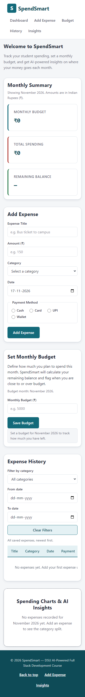

# SpendSmart — AI-Powered Student Expense Tracker

A responsive web application that helps students record expenses, manage a monthly budget, view spending statistics, and receive AI-powered budgeting suggestions.

Built as a course project for the **DSU AI-Powered Full Stack Development** curriculum.

---

## Project Overview

SpendSmart is a student-finance dashboard. Students can:

- Add, edit, and delete expenses
- Categorize expenses (Food, Transport, Shopping, Education, Entertainment, Other)
- Set a monthly budget
- See total spending and remaining balance at a glance
- Filter expenses by category and date
- View category-wise spending charts
- Receive AI-generated spending summaries and budgeting tips

## Objectives

- Practice the full-stack development lifecycle on a real, useful tool for students
- Master responsive UI design with CSS Grid and Flexbox
- Build REST APIs with Node.js and Express
- Store and query expense data in MongoDB
- Integrate an AI model for personalized budgeting advice
- Ship a deployable, tested product

## Current Status — Phases 1, 2 & 3 Complete

This repository currently contains the finished **HTML5 structure**, **CSS3 styling**, and **JavaScript ES6+ functionality** of the dashboard. It runs entirely in the browser with no build step and no server: open `index.html` and it works.

### Completed Features

| Feature | Status |
|---|---|
| Semantic, accessible HTML5 dashboard layout (header, nav, main, footer) | Done |
| Add Expense form with title, amount, category, date, and payment method | Done |
| Add, edit, and delete expenses with confirmation | Done |
| Set and update a monthly budget per calendar month | Done |
| Summary cards: Monthly Budget, Total Spending, Remaining Balance | Done |
| Budget warnings at 80% usage and when the budget is exceeded | Done |
| Expense history table with caption and column scope | Done |
| Filter expenses by category and by date range, with clear-filters | Done |
| Category-wise spending breakdown for the current month | Done |
| Expenses and budgets persisted in LocalStorage with safe parsing | Done |
| Validation for titles, amounts, categories, dates, and payment methods | Done |
| Duplicate-submission prevention | Done |
| Empty states for the table, insights, and budget | Done |
| Polished responsive styling with CSS variables, Grid, and Flexbox | Done |
| Desktop / tablet / mobile layouts with no horizontal page overflow | Done |
| Keyboard focus visibility, reduced-motion support, ARIA landmarks | Done |
| Reserved section for AI insights | Done (placeholder) |

### Screenshots

| Desktop (1280px) | Tablet (768px) | Mobile (375px) |
|---|---|---|
|  |  |  |

### Technology Stack

| Phase | Technology | Status |
|---|---|---|
| 1 | HTML5 | Completed |
| 2 | CSS3 (Grid, Flexbox, custom properties) | Completed |
| 3 | JavaScript ES6+ | Completed |
| 4 | Node.js + Express REST API | Completed |
| 5 | MongoDB + Mongoose | Completed (falls back to temporary in-memory storage when no `MONGODB_URI` is set) |
| 6 | React (Vite) | Completed (`frontend/`, talks to the Phase 4/5 REST API) |
| 7 | AI API integration | Pending |
| 8 | Testing, GitHub, deployment | In progress |

**Not yet implemented:** the AI integration is pending — the AI/insights section remains an intentional placeholder (Phase 7). The API persists to MongoDB when `MONGODB_URI` is set in `backend/.env`; without it, the server falls back to temporary in-memory storage and prints a banner stating this. The Phase 6 React frontend replaces LocalStorage with live API calls. No API keys or credentials exist anywhere in this project yet; when the AI integration is added, keys will live in a server-side `.env` file and will never ship in the frontend (and never in `VITE_` variables, which are public).

## Getting Started

No installation needed for the app itself.

```
phase1-html/index.html  →  open directly in your browser
```

The page is plain HTML + CSS + JavaScript. Double-click it, or start any static server. Expenses and the monthly budget are stored in the browser's LocalStorage under `spendsmart.v1`.

### Running the tests

The repository includes Playwright scripts for the Phase 3 UI (17 tests + responsive check) and for the Phase 6 React app (23 end-to-end checks + responsive check, run against the live backend and Vite dev server — see "Phase 6 end-to-end tests" below).

```
cd phase1-html/tools
npm install
npm test                 # Phase 3 functional tests (17 tests)
npm run test:viewports   # desktop / tablet / mobile overflow check
npm run test:all         # both
```

Expected viewport output (the Amount and Actions columns intentionally scroll *inside* the table on mobile — that is the designed behaviour, not a page-level overflow):

```
[desktop 1280x900] page overflow: false, table overflow: false
[tablet 768x1024]  page overflow: false, table overflow: false
[mobile 375x812]   page overflow: false, table overflow: true (internal table scroll — expected)
```

## Repository Structure

```
.
├── index.html          # dashboard page (Phase 1)
├── styles.css          # all styling (Phase 2)
├── app.js              # application logic (Phase 3)
├── screenshots/        # desktop / tablet / mobile captures
├── tools/
│   ├── test-phase3.js          # Playwright functional tests (Phase 3 UI)
│   ├── test-viewports.js       # Playwright responsive check (Phase 1-3 UI)
│   ├── test-phase6.js          # Playwright end-to-end tests (React UI + API)
│   ├── test-phase6-viewports.js# Playwright responsive check (React UI)
│   ├── package.json
│   └── package-lock.json
├── frontend/                   # Phase 6 React + Vite app
│   ├── index.html
│   ├── vite.config.js
│   ├── .env / .env.example     # VITE_API_URL (public values only)
│   └── src/
│       ├── main.jsx            # entry point
│       ├── App.jsx             # state container: data fetching + composition
│       ├── api/client.js       # reusable REST client (all API calls live here)
│       ├── constants.js        # categories, payment methods, limits
│       ├── utils/format.js     # currency/date/month helpers
│       ├── styles.css          # Phase 2 design ported + Phase 6 status styles
│       └── components/
│           ├── Navbar.jsx           # header + navigation
│           ├── DashboardSummary.jsx # budget/spending/remaining cards + warnings
│           ├── ExpenseForm.jsx      # controlled add/edit form + validation
│           ├── BudgetForm.jsx       # controlled monthly budget form
│           ├── ExpenseFilters.jsx   # category/date filters
│           ├── ExpenseList.jsx      # history table, empty states, edit/delete
│           ├── SpendingChart.jsx    # CSS bar chart of category spending
│           └── InsightsPanel.jsx    # chart section + empty state
└── backend/                # Phase 4/5 REST API
    ├── src/
    │   ├── config/         # env, shared constants, MongoDB connection
    │   ├── controllers/    # request handling + body validators
    │   ├── routes/         # Express routers (/api/expenses, /api/budget)
    │   ├── middleware/     # async wrapper, Mongo error mapping, 404 + centralized error handler
    │   ├── models/         # Mongoose schemas (Expense, Budget)
    │   ├── services/       # domain logic + MongoDB store (in-memory fallback)
    │   ├── utils/          # validation, errors, id helpers
    │   ├── app.js          # Express app factory
    │   └── server.js       # entry point
    ├── tests/
    │   ├── api.test.js     # 32 automated API tests (in-memory store)
    │   └── mongo.test.js   # 8 automated API tests (real MongoDB via mongodb-memory-server)
    ├── demo.js             # scripted API walkthrough
    ├── package.json
    └── .env.example
```

## Backend quick start (Phases 4 & 5)

```bash
cd backend
npm install
copy .env.example .env    # set MONGODB_URI here to persist to MongoDB
npm start                 # http://localhost:5000
npm run dev               # same, with auto-restart on file changes
npm test                  # 40 automated API tests (32 in-memory + 8 MongoDB)
node demo.js              # scripted walkthrough of every endpoint
```

When `MONGODB_URI` is set, expenses and budgets persist across restarts via Mongoose (local MongoDB or Atlas both work). Without it, the API runs on temporary in-memory storage: data is lost on restart, and the server prints a banner stating this.

## Frontend quick start (Phase 6 — React + Vite)

```bash
cd frontend
npm install
npm run dev      # http://localhost:5173 (keep the backend running)
npm run build    # production build into frontend/dist
npm run preview  # serve the production build
```

The backend URL is read from `VITE_API_URL` in `frontend/.env` (see `.env.example`; defaults to `http://localhost:5000`). `VITE_` variables are compiled into the browser bundle, so they must only ever contain public values — no private API keys.

**Running the full stack:**

```bash
# Terminal 1 — backend on http://localhost:5000
cd backend && npm start

# Terminal 2 — frontend on http://localhost:5173
cd frontend && npm run dev
```

The Vite dev server origin (`http://localhost:5173`) is included in the backend's `CORS_ORIGINS` allow-list.

### Phase 6 end-to-end tests

With both servers running:

```bash
cd phase1-html/tools
node test-phase6.js             # 23 checks: full expense workflow through the real UI
node test-phase6-viewports.js   # responsive check at desktop/tablet/mobile widths
```

Both use Playwright (`phase1-html` dev dependency) against the live React app and API.

## Development Roadmap

| Phase | What happens |
|---|---|
| 3 — JavaScript ES6+ | **Completed:** expense add/edit/delete with `localStorage`, budget calculations, category & date filters, live summary cards |
| 4 — Node.js + Express | **Completed:** REST API (`GET/POST/PUT/PATCH/DELETE /api/expenses`, `GET/PUT /api/budget`, `GET /api/health`), validation, CORS, centralized error handling, temporary in-memory storage, API tests, demo script |
| 5 — MongoDB + Mongoose | **Completed:** Expense and Budget schemas, API wired to MongoDB with automatic in-memory fallback, persistence verified by tests against a real MongoDB instance |
| 6 — React (Vite) | **Completed:** dashboard rebuilt as functional components with controlled forms, all data served by the Express API (no LocalStorage), loading/empty/error states, responsive design preserved |
| 7 — AI integration | Server-side AI endpoint (key kept in `.env`, never in frontend) producing spending summaries and budgeting suggestions |
| 8 — Testing & deployment | Unit/API tests, CI, deployment of the full stack |

## License

MIT — see [LICENSE](LICENSE).
