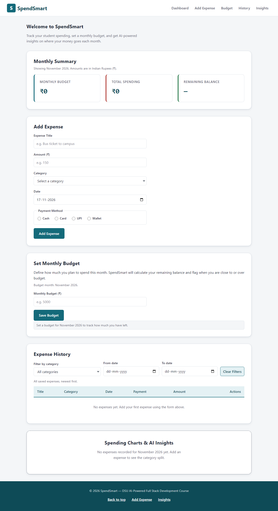
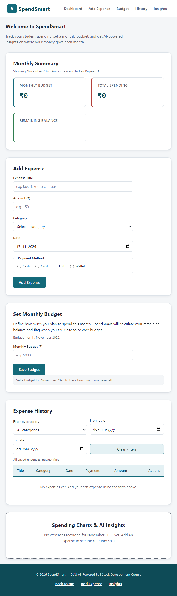

# SpendSmart — AI-Powered Student Expense Tracker

A responsive web application that helps students record expenses, manage a monthly budget, view spending statistics, and receive AI-powered budgeting suggestions.

Built as a course project for the **DSU AI-Powered Full Stack Development** curriculum.

---

## Project Overview

SpendSmart is a student-finance dashboard. Students can:

- Add, edit, and delete expenses
- Categorize expenses (Food, Transport, Shopping, Education, Entertainment, Other)
- Set a monthly budget
- See total spending and remaining balance at a glance
- Filter expenses by category and date
- View category-wise spending charts
- Receive AI-generated spending summaries and budgeting tips

## Objectives

- Practice the full-stack development lifecycle on a real, useful tool for students
- Master responsive UI design with CSS Grid and Flexbox
- Build REST APIs with Node.js and Express
- Store and query expense data in MongoDB
- Integrate an AI model for personalized budgeting advice
- Ship a deployable, tested product

## Current Status — Phases 1–7 Complete

All seven development phases are finished and verified: the React frontend, the Express + MongoDB backend, and the AI insights feature. See [SUBMISSION.md](SUBMISSION.md) for the faculty demo checklist, deployment instructions, and known limitations.

### Completed Features

| Feature | Status |
|---|---|
| Semantic, accessible dashboard (Phase 1 HTML) | Done |
| Responsive CSS (Grid, Flexbox, custom properties) (Phase 2) | Done |
| Add/edit/delete expenses, budget, filters, charts (Phase 3, vanilla JS demo) | Done |
| Express REST API with validation and centralised errors (Phase 4) | Done |
| MongoDB + Mongoose persistence with in-memory fallback (Phase 5) | Done |
| React (Vite) frontend wired to the API (Phase 6) | Done |
| AI spending insights with verified calculations and safe fallback (Phase 7) | Done |
| Automated tests: 68 backend + 63 UI/browser checks | Done |

### Screenshots

| Desktop (1280px) | Tablet (768px) | Mobile (375px) |
|---|---|---|
|  |  |  |

### Technology Stack

| Phase | Technology | Status |
|---|---|---|
| 1 | HTML5 | Completed |
| 2 | CSS3 (Grid, Flexbox, custom properties) | Completed |
| 3 | JavaScript ES6+ | Completed |
| 4 | Node.js + Express REST API | Completed |
| 5 | MongoDB + Mongoose | Completed (falls back to temporary in-memory storage when no `MONGODB_URI` is set) |
| 6 | React (Vite) | Completed (`frontend/`, talks to the Phase 4/5 REST API) |
| 7 | AI API integration | Completed (Claude via the official Anthropic SDK; deterministic fallback when no key is configured) |
| 8 | Testing, GitHub, deployment | In progress |

**Not yet implemented:** deployment (Phase 8). The API persists to MongoDB when `MONGODB_URI` is set in `backend/.env`; without it, the server falls back to temporary in-memory storage and prints a banner stating this. The Phase 6 React frontend replaces LocalStorage with live API calls. The Phase 7 AI narrative calls Claude from the backend only: the key lives in `backend/.env` (`ANTHROPIC_API_KEY`), is never sent to the browser, and never appears in `VITE_` variables (which are public). Without a key the endpoint still works, returning a deterministic offline summary labelled as fallback.

## Prerequisites

| Tool | Version | Needed for |
|---|---|---|
| Node.js | 18+ (20+ recommended) | backend, frontend build |
| npm | 9+ | dependency install |
| MongoDB | 6+ local, or a free Atlas cluster | persistence (optional — the API falls back to in-memory storage without it) |
| Anthropic API key | any paid/credit API key | AI-generated narratives (optional — a labelled offline summary is used without it) |

## Architecture

```
┌─────────────────────────────┐  HTTPS/JSON   ┌──────────────────────────────┐  Mongoose  ┌────────────┐
│ React 19 + Vite (port 5173) │ ────────────> │ Express API (port 5000)      │ ─────────> │ MongoDB    │
│ components + api client     │               │ routes → controllers →       │            │ (optional; │
│ VITE_API_URL ───────────────┘               │ services → stores            │            │ in-memory  │
│                                              │            │                                │ fallback)  │
│                                              │            └──> Anthropic API (AI narrative,│
│                                              │                key server-side only)        │
└──────────────────────────────────────────────└─────────────────────────────────────────────┘
```

- **Frontend** (`frontend/`): React 19 functional components; all HTTP calls live in one
  module (`src/api/client.js`); the backend URL comes from the `VITE_API_URL` env variable.
- **Backend** (`backend/`): layered Express app — routes → controllers (validation) →
  services (domain logic) → stores (MongoDB via Mongoose, or in-memory fallback). The same
  store interface powers both, so tests run without a database.
- **AI layer** (`backend/src/services/aiNarrative.js`): deterministic statistics are computed
  first; the AI only writes prose about them. Replies are validated (no invented ₹ amounts)
  and any failure degrades to a labelled offline summary. The API key never leaves the server.

## Getting Started

No installation needed for the app itself.

```
phase1-html/index.html  →  open directly in your browser
```

The page is plain HTML + CSS + JavaScript. Double-click it, or start any static server. Expenses and the monthly budget are stored in the browser's LocalStorage under `spendsmart.v1`.

### Running the tests

The repository includes Playwright scripts for the Phase 3 UI (17 tests + responsive check), the Phase 6 React app (23 end-to-end checks + responsive check), the Phase 7 AI insights flow (10 checks), and a submission audit (39 API edge cases + 13 browser/console/accessibility checks) — all run against the live backend and Vite dev server. See [SUBMISSION.md](SUBMISSION.md) for the full test evidence table.

```
cd phase1-html/tools
npm install
npm test                 # Phase 3 functional tests (17 tests)
npm run test:viewports   # desktop / tablet / mobile overflow check
npm run test:all         # both
```

Expected viewport output (the Amount and Actions columns intentionally scroll *inside* the table on mobile — that is the designed behaviour, not a page-level overflow):

```
[desktop 1280x900] page overflow: false, table overflow: false
[tablet 768x1024]  page overflow: false, table overflow: false
[mobile 375x812]   page overflow: false, table overflow: true (internal table scroll — expected)
```

## Repository Structure

```
.
├── index.html          # dashboard page (Phase 1)
├── styles.css          # all styling (Phase 2)
├── app.js              # application logic (Phase 3)
├── screenshots/        # desktop / tablet / mobile captures
├── tools/
│   ├── test-phase3.js          # Playwright functional tests (Phase 3 UI)
│   ├── test-viewports.js       # Playwright responsive check (Phase 1-3 UI)
│   ├── test-phase6.js          # Playwright end-to-end tests (React UI + API)
│   ├── test-phase6-viewports.js# Playwright responsive check (React UI)
│   ├── package.json
│   └── package-lock.json
├── frontend/                   # Phase 6 React + Vite app
│   ├── index.html
│   ├── vite.config.js
│   ├── .env / .env.example     # VITE_API_URL (public values only)
│   └── src/
│       ├── main.jsx            # entry point
│       ├── App.jsx             # state container: data fetching + composition
│       ├── api/client.js       # reusable REST client (all API calls live here)
│       ├── constants.js        # categories, payment methods, limits
│       ├── utils/format.js     # currency/date/month helpers
│       ├── styles.css          # Phase 2 design ported + Phase 6 status styles
│       └── components/
│           ├── Navbar.jsx           # header + navigation
│           ├── DashboardSummary.jsx # budget/spending/remaining cards + warnings
│           ├── ExpenseForm.jsx      # controlled add/edit form + validation
│           ├── BudgetForm.jsx       # controlled monthly budget form
│           ├── ExpenseFilters.jsx   # category/date filters
│           ├── ExpenseList.jsx      # history table, empty states, edit/delete
│           ├── SpendingChart.jsx    # CSS bar chart of category spending
│           └── InsightsPanel.jsx    # chart section + empty state
└── backend/                # Phase 4/5 REST API
    ├── src/
    │   ├── config/         # env, shared constants, MongoDB connection
    │   ├── controllers/    # request handling + body validators
    │   ├── routes/         # Express routers (/api/expenses, /api/budget)
    │   ├── middleware/     # async wrapper, Mongo error mapping, 404 + centralized error handler
    │   ├── models/         # Mongoose schemas (Expense, Budget)
    │   ├── services/       # domain logic, MongoDB store (in-memory fallback),
    │   │                   # deterministic insights (insightsService) and the
    │   │                   # AI narrative layer (aiNarrative)
    │   ├── utils/          # validation, errors, id, month + money helpers
    │   ├── app.js          # Express app factory
    │   └── server.js       # entry point
    ├── tests/
    │   ├── api.test.js         # 32 automated API tests (in-memory store)
    │   ├── mongo.test.js       # 8 automated API tests (real MongoDB via mongodb-memory-server)
    │   ├── insights.test.js    # 16 automated tests: deterministic insights + endpoint
    │   └── aiNarrative.test.js # 11 automated tests: AI narrator with a stubbed SDK client
    ├── demo.js             # scripted API walkthrough
    ├── package.json
    └── .env.example
```

## Backend quick start (Phases 4 & 5)

```bash
cd backend
npm install
copy .env.example .env    # set MONGODB_URI here to persist to MongoDB
npm start                 # http://localhost:5000
npm run dev               # same, with auto-restart on file changes
npm test                  # 67 automated API tests (32 in-memory, 8 MongoDB,
                          # 16 insights, 11 AI narrator — no API key needed)
node demo.js              # scripted walkthrough of every endpoint
```

When `MONGODB_URI` is set, expenses and budgets persist across restarts via Mongoose (local MongoDB or Atlas both work). Without it, the API runs on temporary in-memory storage: data is lost on restart, and the server prints a banner stating this.

### Environment variables

**Backend (`backend/.env`, copied from `backend/.env.example`):**

| Variable | Required | Default | Purpose |
|---|---|---|---|
| `PORT` | no | `5000` | API port |
| `NODE_ENV` | no | `development` | `production` hides internal error details |
| `CORS_ORIGINS` | no | localhost dev origins | Comma-separated list of allowed browser origins |
| `MONGODB_URI` | no | *(empty)* | MongoDB connection string; empty = in-memory storage |
| `ANTHROPIC_API_KEY` | no | *(empty)* | Enables the Claude-generated narrative; empty = offline summary |
| `AI_MODEL` | no | `claude-sonnet-5-5` | Model used for the narrative |

**Frontend (`frontend/.env`, copied from `frontend/.env.example`):**

| Variable | Required | Default | Purpose |
|---|---|---|---|
| `VITE_API_URL` | no | `http://localhost:5000` | Backend base URL. Public by design — never put secrets in `VITE_` variables. |

## API endpoints

| Method | Path | Purpose |
|---|---|---|
| GET | `/api/health` | Service status and storage mode |
| GET | `/api/expenses` | All expenses (newest first) with `count` |
| POST | `/api/expenses` | Create an expense |
| GET | `/api/expenses/:id` | One expense |
| PUT | `/api/expenses/:id` | Replace all editable fields |
| PATCH | `/api/expenses/:id` | Update supplied fields |
| DELETE | `/api/expenses/:id` | Delete an expense |
| GET | `/api/budget` | Current month's budget |
| PUT | `/api/budget` | Set the current month's budget (`{ "amount": 5000 }`) |
| POST | `/api/insights` | Spending insights for a month (`{ "month": "YYYY-MM" }`, optional); rate-limited to one call per 10s |

All responses use the envelope `{ "success": true, "data": ... }` or
`{ "success": false, "error": { "message", "fields?" } }` with appropriate HTTP status codes
(400 validation, 404 unknown record, 429 rate limit, 500 unexpected).

## Frontend quick start (Phase 6 — React + Vite)

```bash
cd frontend
npm install
npm run dev      # http://localhost:5173 (keep the backend running)
npm run build    # production build into frontend/dist
npm run preview  # serve the production build
```

The backend URL is read from `VITE_API_URL` in `frontend/.env` (see `.env.example`; defaults to `http://localhost:5000`). `VITE_` variables are compiled into the browser bundle, so they must only ever contain public values — no private API keys.

**Running the full stack:**

```bash
# Terminal 1 — backend on http://localhost:5000
cd backend && npm start

# Terminal 2 — frontend on http://localhost:5173
cd frontend && npm run dev
```

The Vite dev server origin (`http://localhost:5173`) is included in the backend's `CORS_ORIGINS` allow-list.

### Phase 6 end-to-end tests

With both servers running:

```bash
cd phase1-html/tools
node test-phase6.js             # 23 checks: full expense workflow through the real UI
node test-phase6-viewports.js   # responsive check at desktop/tablet/mobile widths
```

Both use Playwright (`phase1-html` dev dependency) against the live React app and API.

## AI insights (Phase 7)

`POST /api/insights` (body: `{ "month": "YYYY-MM" }`, optional — defaults to the current month)
returns:

- `calculations` — verified numbers computed by backend code from real expense records:
  totals, per-category amounts and percentages, top categories, biggest riser versus last
  month, budget remaining and usage, largest expenses.
- `narrative` — a plain-language summary, spending patterns, and 2-4 budgeting suggestions.
  This is generated by Claude (model `claude-sonnet-5-5` via the official `@anthropic-ai/sdk`)
  when `ANTHROPIC_API_KEY` is set in `backend/.env`, or by a deterministic offline summary
  otherwise. `narrativeSource` ('ai' | 'fallback') and `aiStatus` say which one you got.
- The AI is only ever *interpreting* pre-computed figures: the prompt forbids inventing
  amounts, and the reply is rejected (falling back to the offline summary) if it mentions a
  ₹ amount that does not exist in the payload. Timeouts, rate limits, and service errors
  degrade gracefully; nothing recorded for the month returns a friendly "add some expenses
  first" message without calling the AI at all.

The frontend's "Get AI Insights" button (in the Spending Charts & AI Insights section) calls
this endpoint and always labels the narrative source; suggestions carry a disclaimer that
they are general guidance, not a guarantee of savings.

**Configuration:** add `ANTHROPIC_API_KEY=sk-ant-...` to `backend/.env` (server-side only —
never in `frontend/.env`, never in any `VITE_` variable). Optional: `AI_MODEL` overrides the
model. Without a key, everything works and the UI shows the offline summary, clearly labelled.

```bash
cd phase1-html/tools
node test-phase7.js             # 10 checks: AI insights workflow through the real UI
```

## Development Roadmap

| Phase | What happens |
|---|---|
| 3 — JavaScript ES6+ | **Completed:** expense add/edit/delete with `localStorage`, budget calculations, category & date filters, live summary cards |
| 4 — Node.js + Express | **Completed:** REST API (`GET/POST/PUT/PATCH/DELETE /api/expenses`, `GET/PUT /api/budget`, `GET /api/health`), validation, CORS, centralized error handling, temporary in-memory storage, API tests, demo script |
| 5 — MongoDB + Mongoose | **Completed:** Expense and Budget schemas, API wired to MongoDB with automatic in-memory fallback, persistence verified by tests against a real MongoDB instance |
| 6 — React (Vite) | **Completed:** dashboard rebuilt as functional components with controlled forms, all data served by the Express API (no LocalStorage), loading/empty/error states, responsive design preserved |
| 7 — AI integration | Server-side AI endpoint (key kept in `.env`, never in frontend) producing spending summaries and budgeting suggestions |
| 8 — Testing & deployment | Unit/API tests, CI, deployment of the full stack |

## License

MIT — see [LICENSE](LICENSE).
