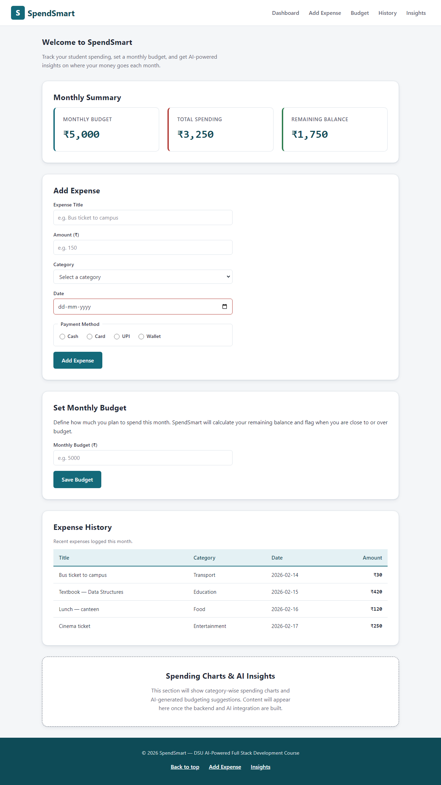
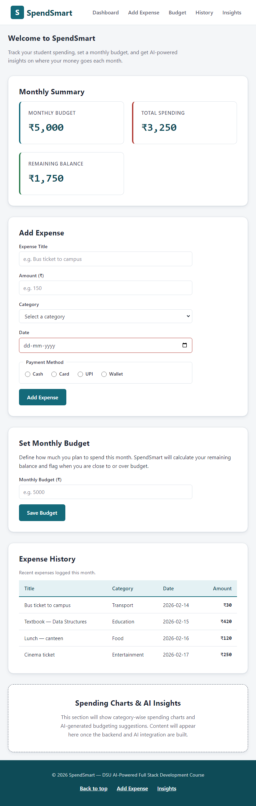
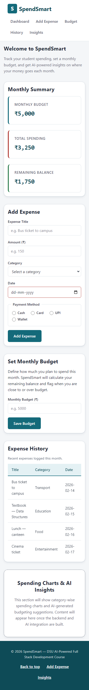

# SpendSmart — AI-Powered Student Expense Tracker

A responsive web application that helps students record expenses, manage a monthly budget, view spending statistics, and receive AI-powered budgeting suggestions.

Built as a course project for the **DSU AI-Powered Full Stack Development** curriculum.

---

## Project Overview

SpendSmart is a student-finance dashboard. Students can:

- Add, edit, and delete expenses
- Categorize expenses (Food, Transport, Shopping, Education, Entertainment, Other)
- Set a monthly budget
- See total spending and remaining balance at a glance
- Filter expenses by category and date
- View category-wise spending charts
- Receive AI-generated spending summaries and budgeting tips

## Objectives

- Practice the full-stack development lifecycle on a real, useful tool for students
- Master responsive UI design with CSS Grid and Flexbox
- Build REST APIs with Node.js and Express
- Store and query expense data in MongoDB
- Integrate an AI model for personalized budgeting advice
- Ship a deployable, tested product

## Current Status — Phases 1 & 2 Complete

This repository currently contains the finished **HTML5 structure** and **CSS3 styling** of the dashboard. It is a fully static, responsive site: open `index.html` in any browser and it works, no build step, no server.

### Completed Features

| Feature | Status |
|---|---|
| Semantic, accessible HTML5 dashboard layout (header, nav, main, footer) | Done |
| Add Expense form with native validation (title, amount, category, date, payment method) | Done |
| Set Monthly Budget form | Done |
| Summary cards: Monthly Budget, Total Spending, Remaining Balance | Done |
| Expense history table with caption and column scope | Done |
| Polished responsive styling with CSS variables, Grid, and Flexbox | Done |
| Desktop / tablet / mobile layouts with no horizontal page overflow | Done |
| Keyboard focus visibility, reduced-motion support, ARIA landmarks | Done |
| Reserved section for spending charts and AI insights | Done (placeholder) |

### Screenshots

| Desktop (1280px) | Tablet (768px) | Mobile (375px) |
|---|---|---|
|  |  |  |

### Technology Stack

| Phase | Technology | Status |
|---|---|---|
| 1 | HTML5 | Completed |
| 2 | CSS3 (Grid, Flexbox, custom properties) | Completed |
| 3 | JavaScript ES6+ | Pending |
| 4 | Node.js + Express REST API | Pending |
| 5 | MongoDB + Mongoose | Pending |
| 6 | React (Vite) | Pending |
| 7 | AI API integration | Pending |
| 8 | Testing, GitHub, deployment | In progress |

**Not yet implemented:** JavaScript interactivity, any backend, a database, the React frontend, and AI integration are all pending — the AI/insights section is an intentional placeholder. No API keys or credentials exist anywhere in this project yet; when the AI integration is added, keys will live in a server-side `.env` file and will never ship in the frontend.

## Getting Started

No installation needed for the current site.

```
phase1-html/index.html  →  open directly in your browser
```

The page is plain HTML + CSS. Double-click it, or start any static server.

### Running the responsive-layout test

The repository includes a Playwright script that loads the page at desktop, tablet, and mobile sizes and reports whether any element overflows the viewport:

```
cd phase1-html/tools
npm install
npm start
```

Expected output (the Amount column intentionally scrolls *inside* the table on mobile — that is the designed behavior, not a page-level overflow):

```
[desktop 1280x900] page overflow: false, table overflow: false
[tablet 768x1024]  page overflow: false, table overflow: false
[mobile 375x812]   page overflow: false, table overflow: true (internal table scroll — expected)
```

## Repository Structure

```
.
├── index.html          # dashboard page (Phase 1)
├── styles.css          # all styling (Phase 2)
├── screenshots/        # desktop / tablet / mobile captures
└── tools/
    ├── test-viewports.js   # Playwright responsive-layout check
    ├── package.json
    └── package-lock.json
```

## Development Roadmap

| Phase | What happens |
|---|---|
| 3 — JavaScript ES6+ | Expense add/edit/delete with `localStorage`, budget calculations, category & date filters, live summary cards |
| 4 — Node.js + Express | REST API: `GET/POST/PUT/DELETE /api/expenses`, budget endpoint, input validation |
| 5 — MongoDB + Mongoose | Expense and Budget schemas, API wired to MongoDB, history persistence |
| 6 — React (Vite) | Dashboard rebuilt in React: components, state management, API calls, charts |
| 7 — AI integration | Server-side AI endpoint (key kept in `.env`, never in frontend) producing spending summaries and budgeting suggestions |
| 8 — Testing & deployment | Unit/API tests, CI, deployment of the full stack |

## License

MIT — see [LICENSE](LICENSE).
